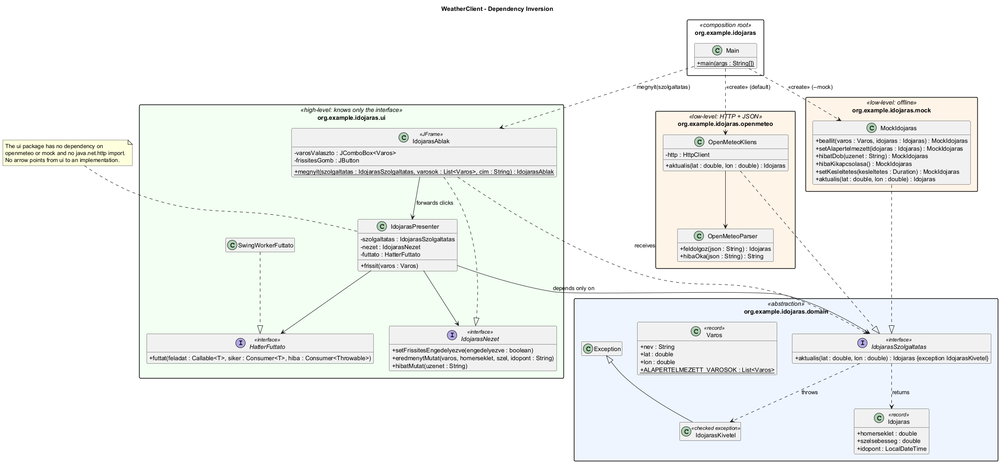
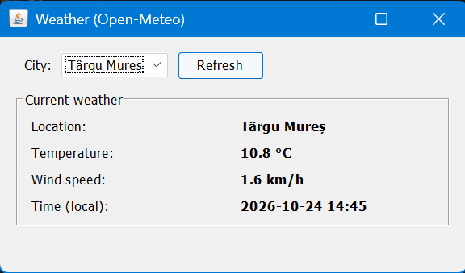

# WeatherClient

A Java Swing desktop app that shows the current temperature, wind speed and time for a few
cities, using the free, keyless [Open-Meteo](https://open-meteo.com/) API.

The point of the project is the **Dependency Inversion Principle**: the UI has no idea that HTTP
exists. It talks to the `IdojarasSzolgaltatas` interface, which has two implementations: the real
`OpenMeteoKliens` and the offline `MockIdojaras`. `main` picks one with a command-line flag.

## Requirements

- JDK 25 (`java -version`)
- No Maven installation is needed: the project includes the Maven Wrapper (`mvnw` / `mvnw.cmd`),
  which downloads the right Maven version on first use.
- Internet access for real mode (and for the first build, to download dependencies).

## Build and test

Windows (PowerShell or cmd):

```powershell
.\mvnw.cmd clean package      # compiles, runs all tests, builds target\weather-client.jar
.\mvnw.cmd test               # tests only
```

Linux / macOS / Git Bash:

```bash
./mvnw clean package
./mvnw test
```

`package` produces `target/weather-client.jar`, a runnable jar that already contains Jackson.

## Run

| Mode | Implementation | Command |
|---|---|---|
| Real | `OpenMeteoKliens` (live data) | `java -jar target/weather-client.jar` |
| Mock | `MockIdojaras` (fixed offline data) | `java -jar target/weather-client.jar --mock` |
| Mock error | `MockIdojaras` set to always throw | `java -jar target/weather-client.jar --mock-error` |

On Windows use `target\weather-client.jar`. The window title shows the active mode.

You can also run straight from Maven without packaging:

```powershell
# Windows PowerShell (the quotes around -D... are required in PowerShell)
.\mvnw.cmd compile exec:java                               # real mode
.\mvnw.cmd compile exec:java "-Dexec.args=--mock"          # mock mode
.\mvnw.cmd compile exec:java "-Dexec.args=--mock-error"    # mock error mode
```

```bash
# Linux / macOS / Git Bash
./mvnw compile exec:java
./mvnw compile exec:java -Dexec.args=--mock
./mvnw compile exec:java -Dexec.args=--mock-error
```

In mock mode every "request" takes 0.8 s on purpose, so you can see the Refresh button disabled
and the "Loading…" status. The mock data per city:

| City | Temperature | Wind |
|---|---|---|
| Târgu Mureș | 12.5 °C | 8.3 km/h |
| Cluj-Napoca | 10.2 °C | 14.0 km/h |
| Brașov | 7.8 °C | 5.6 km/h |
| București | 16.4 °C | 11.2 km/h |
| Budapest | 14.1 °C | 18.5 km/h |
| Wien | 11.9 °C | 22.7 km/h |

## Open-Meteo API

Example request (Târgu Mureș), exactly as `OpenMeteoKliens` builds it:

```
https://api.open-meteo.com/v1/forecast?latitude=46.54&longitude=24.56&current=temperature_2m,wind_speed_10m&timezone=auto
```

`timezone=auto` makes the API report `current.time` in the city's local time.

Example response (captured 2026-10-24):

```json
{
  "latitude": 46.54601,
  "longitude": 24.56224,
  "generationtime_ms": 0.04887580871582031,
  "utc_offset_seconds": 10800,
  "timezone": "Europe/Bucharest",
  "timezone_abbreviation": "GMT+3",
  "elevation": 330.0,
  "current_units": {
    "time": "iso8601",
    "interval": "seconds",
    "temperature_2m": "°C",
    "wind_speed_10m": "km/h"
  },
  "current": {
    "time": "2026-10-24T13:45",
    "interval": 900,
    "temperature_2m": 10.7,
    "wind_speed_10m": 1.0
  }
}
```

Only `current.time`, `current.temperature_2m` and `current.wind_speed_10m` are used. For an
invalid request the API answers HTTP 400 with `{"error": true, "reason": "..."}`, and the reason
is shown in the error dialog.

## JSON library: Jackson

The response is parsed with **Jackson** (`jackson-databind`), using its tree model
(`ObjectMapper.readTree` → `JsonNode`), in the separate class `OpenMeteoParser`.

- **Strict.** Jackson rejects invalid input: truncated JSON, HTML error pages, and (with
  `FAIL_ON_TRAILING_TOKENS`) garbage after the JSON. Gson's tree parser is lenient by default
  and accepts some non-standard JSON, which works against the goal of reporting malformed
  responses.
- **Tree model, no DTOs.** We only need three fields. `JsonNode` lets the parser check each
  one separately (`isNumber()`, `isTextual()`) and give a precise error message ("'current.
  wind_speed_10m' is missing or not a number") without writing classes that mirror the response.
- **Safer than parsing by hand.** A hand-written parser would need to deal with escapes,
  number formats and nesting correctly, which is easy to get wrong and adds code to test.
- **Widely used and well maintained.** It's the de-facto standard JSON library for Java.

The cost is a bigger runnable jar (~2.3 MB), which doesn't matter for a desktop app.

## Design: Dependency Inversion



The class diagram source is [`docs/class-diagram.puml`](docs/class-diagram.puml) (PlantUML);
`docs/class-diagram.png` is rendered from it. To re-render after a change:
`java -jar plantuml.jar -tpng docs/class-diagram.puml`, or use the IntelliJ PlantUML plugin.

```
org.example.idojaras
├── Main                       composition root: the only place that creates a concrete service
├── domain                     the abstraction, no HTTP/JSON/Swing
│   ├── IdojarasSzolgaltatas   interface: Idojaras aktualis(lat, lon) throws IdojarasKivetel
│   ├── Idojaras               record: temperature, wind speed, timestamp
│   ├── IdojarasKivetel        checked exception
│   └── Varos                  record: city name + coordinates, preset city list
├── openmeteo                  low-level detail: HTTP + JSON
│   ├── OpenMeteoKliens        implements IdojarasSzolgaltatas with java.net.http.HttpClient
│   └── OpenMeteoParser        JSON → Idojaras, testable without network
├── mock                       low-level detail: offline
│   └── MockIdojaras           implements IdojarasSzolgaltatas with configurable fixed data/errors
└── ui                         high-level: depends only on the interface
    ├── IdojarasPresenter      the logic: disable button, fetch in background, update view / report error
    ├── IdojarasNezet          view interface the presenter talks to
    ├── IdojarasAblak          the Swing JFrame, implements IdojarasNezet
    ├── HatterFuttato          "run in background" interface
    └── SwingWorkerFuttato     HatterFuttato using SwingWorker
```

**How the DIP applies here.** Without the interface, the high-level UI would call the low-level
HTTP client directly and depend on it. Instead, both depend on an abstraction:

- `IdojarasSzolgaltatas` lives in `domain`, next to the types it uses. It is shaped by what the
  UI needs ("give me the weather at these coordinates"), not by how HTTP works.
- `IdojarasPresenter` and `IdojarasAblak` only reference `IdojarasSzolgaltatas`. The `ui`
  package does not import anything from `openmeteo` or `mock`, nor `java.net.http`.
- `OpenMeteoKliens` and `MockIdojaras` both realize the interface. All transport errors
  (`IOException`, HTTP status codes, Jackson exceptions) are translated into `IdojarasKivetel`,
  so no HTTP detail leaks through the interface.
- Only `Main` knows the concrete classes. `new OpenMeteoKliens()` appears nowhere else.

What we gain from this:

- Mock mode, where the app runs fully offline.
- Tests for the presenter with a Mockito mock instead of the network.
- A different provider could be swapped in by changing a single line in `Main`.

**Threading.** The request never runs on the Event Dispatch Thread. The presenter hands the call
to a `HatterFuttato`. In the app this is `SwingWorkerFuttato`: `doInBackground()` calls the
service on a worker thread, and `done()` delivers the result or the exception back on the EDT. The
presenter disables the Refresh button before the request and re-enables it on both success and
failure. Because `HatterFuttato` is an interface, the presenter tests run it synchronously,
without Swing.

## Tests

`.\mvnw.cmd test` runs 40 JUnit 5 tests, none of which need internet access:

| Test class | What it covers |
|---|---|
| `OpenMeteoParserTest` | Parsing a real response captured from the API; 16 malformed inputs (empty, HTML, truncated, trailing garbage, missing or wrongly typed fields, bad time) each give `IdojarasKivetel`; the Open-Meteo error body is reported with its reason. |
| `OpenMeteoKliensTest` | The real client against a local in-process HTTP server: query parameters, HTTP 400/503, malformed body, connection refused. In every failure case the client throws `IdojarasKivetel`. |
| `MockIdojarasTest` | Default value, per-city values, error mode (throws `IdojarasKivetel`), switching the error off again. |
| `IdojarasPresenterTest` | Mockito: the service and view are mocked. On success the button is disabled → re-enabled and the view gets the formatted values. On failure (mocked service, or a `MockIdojaras` set to throw) the button is re-enabled and the error is reported. Also checks that the service is called only inside the background task. |
| `SwingWorkerFuttatoTest` | The task runs off the EDT and callbacks run on the EDT; exceptions reach the error callback unwrapped. |

## Screenshots

Screenshots are in [`docs/screenshots/`](docs/screenshots).

**Real mode** (`java -jar target/weather-client.jar`): live data from Open-Meteo.



Recording: [`real-mode-demo.mp4`](docs/screenshots/real-mode-demo.mp4) (12 s). Switching between
Cluj-Napoca, București, Târgu Mureș and Wien in real mode and refreshing each one.

**Mock mode** (`java -jar target/weather-client.jar --mock`): fixed offline data (see the table
under [Run](#run)).


**Error message** (`java -jar target/weather-client.jar --mock-error`): the `JOptionPane` shown
when the service throws `IdojarasKivetel`.


